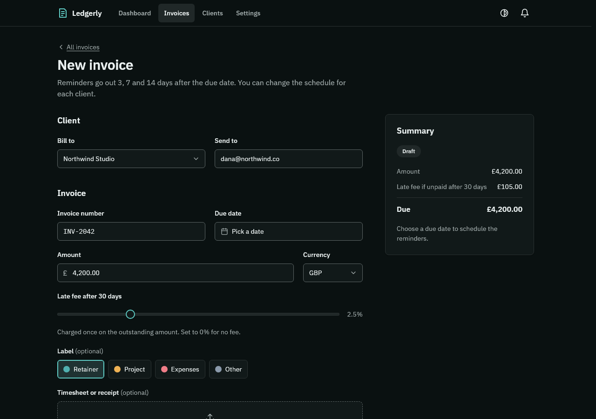
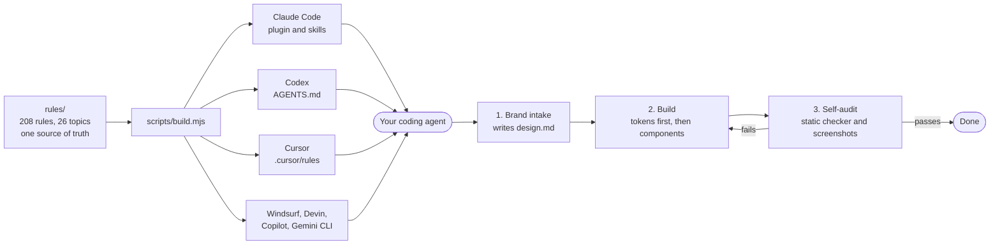
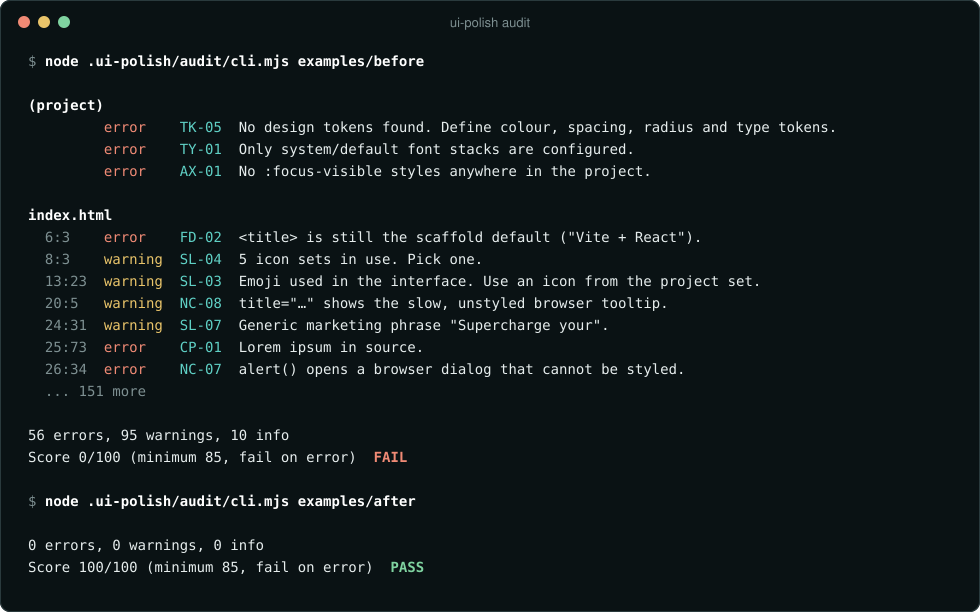

<p align="center">
  
</p>

<p align="center">
  <a href="LICENSE"></a>
  
  
  
  
  
  
  
  <a href="CONTRIBUTING.md"></a>
</p>

<h3 align="center">Your AI agent builds the UI. This makes it look finished.</h3>

<p align="center">
  Rules, ready-made components and an audit you hand to your coding agent,<br>
  so the interfaces it builds stop looking generic and stop shipping with the gaps nobody gets round to fixing.
</p>

<p align="center">
  Works with <b>Claude Code</b> · <b>Codex</b> · <b>Cursor</b> · <b>Windsurf / Devin Desktop</b> · <b>GitHub Copilot</b> · <b>Gemini CLI</b>
</p>

<p align="center">
  <a href="#quick-start">Quick start</a> ·
  <a href="#before-and-after">Before and after</a> ·
  <a href="#does-it-work">Does it work?</a> ·
  <a href="#what-the-rules-cover">The rules</a> ·
  <a href="#components">Components</a> ·
  <a href="#the-audit">The audit</a> ·
  <a href="#elevate-from-correct-to-premium">Elevate</a> ·
  <a href="#install">Install</a> ·
  <a href="#faq">FAQ</a>
</p>

---

## Quick start

**Claude Code**, from any project:

```bash
claude plugin marketplace add devsharmagrowleads-oss/ui-polish-kit
claude plugin install ui-polish-kit@ui-polish-kit
```

**Codex, Cursor, Windsurf, Copilot or Gemini CLI**, in your project root:

```bash
npx github:devsharmagrowleads-oss/ui-polish-kit install cursor   # or codex, windsurf, copilot, gemini, all
```

Then tell your agent: **"Do the brand intake, then run the UI audit."** From then on it follows the rules on every UI task and has to pass the audit before it says the work is done. To take a working UI to premium, say **"Run the UI elevate."**

## Before and after

The same invoicing screen, built twice. Left: what an agent produces when asked for "a SaaS dashboard". Right: the same screen built with the kit. Both are in [`examples/`](examples); open the two `index.html` files to compare.

<table>
  <tr>
    <th width="50%">Before: <code>examples/before</code></th>
    <th width="50%">After: <code>examples/after</code></th>
  </tr>
  <tr>
    <td></td>
    <td></td>
  </tr>
  <tr>
    <td align="center">Score <b>0 / 100</b> · 58 errors · 101 warnings</td>
    <td align="center">Score <b>100 / 100</b> · no findings</td>
  </tr>
</table>

### What it fixes

Ask an agent for a SaaS screen and the result usually works, and usually has these problems:

| You get | With the kit |
| --- | --- |
| A styled page with a grey browser-default dropdown and the blue native date picker in the middle of it | Every control styled to match: selects, date pickers, file uploads, checkboxes, tooltips, dialogs |
| Inter, a purple-to-blue gradient, gradient headline text, emoji as icons, three identical feature cards | A typeface chosen for the product, the brand's colours, one icon set, layouts shaped by the content |
| Padding that changes from card to card; hex colours typed in forty places | One spacing scale and one set of design tokens, used everywhere |
| No hover, focus, loading, empty or error states; no dark mode, or one with white dropdowns | Every state designed; dark mode from redefined tokens |
| A table of divs with left-aligned numbers; a chart with the default rainbow and no units | Real tables with sortable headers and aligned numbers; honest, labelled charts |
| "Vite + React" in the browser tab, no favicon, lorem ipsum, a button that says "Submit" | A real title, favicon, social preview, 404 page, and words that say what things do |

## Does it work?

We gave Claude Code the same three prompts twice, in empty folders: once as it is, once with the kit installed. Same tools, no other plugins. Each result was scored by the kit's static checker (85 passes).

| Prompt | Without the kit | With the kit |
| --- | --- | --- |
| Invoicing dashboard: navigation, summary numbers, revenue chart, sortable invoice table | **53** / 100 · 13 errors | **100** / 100 · 0 errors |
| Landing page: hero, features, pricing, FAQ, dark mode toggle | **47** / 100 · 11 errors | **96** / 100 · 0 errors |

Without the kit, the agent shipped browser-default selects and date pickers, emoji as icons, hard-coded colours, no favicon or social preview, `href="#"` links and unlabelled icons. With the kit all of those were gone; what remained was a missing 404 page on one and incomplete social-preview tags on the other.

One run per prompt, judged by the kit's own checker, which reads code rather than pixels, so read it as a strong signal rather than a benchmark. Run it yourself with [`node scripts/eval/run.mjs`](scripts/eval/run.mjs) (needs the `claude` CLI; prompts in [`prompts.json`](scripts/eval/prompts.json)).

## How it works



1. **Brand intake.** The agent looks for your colours, fonts, logo and tone, asks you for what is missing, and writes `design.md`, including whether the project is a marketing site, a product app (SaaS, dashboard, admin tool) or both. Everything later follows it, and rules written only for landing pages or only for apps apply only where they fit.
2. **Build.** Design tokens first, then components from the recipes, mobile layout first. Before building a dialog, menu or animation it looks up [Modern Web Guidance](#works-with-modern-web-guidance) to use the browser's own feature.
3. **Self-audit.** It runs the static checker, takes screenshots at three widths in light and dark, looks at them, fixes what fails, and only then reports the work as done, with the score.

Each agent gets a short entry file that is always loaded (the core checklist and a list of topics, about 8,000 characters). The detailed topic files are loaded only when the work touches them, because long always-on rule files get ignored.

## What the rules cover

208 rules in 26 topics. Each rule has the rule, why it matters, a bad example, a good example and how to check it.

**Look and feel**

| Topic | What it stops |
| --- | --- |
| [Design tokens](rules/02-design-tokens.md) · TK | Hard-coded hex colours and arbitrary pixel values scattered through components |
| [Typography](rules/03-typography.md) · TY | The same default font every time; includes 14 Google Font pairings by product personality |
| [Spacing and layout](rules/04-spacing-layout.md) · SP | Padding that changes from card to card, no rhythm, no grid |
| [Colour](rules/12-colour.md) · CO | Unplanned palettes, no neutral scale, accent colour on everything |
| [Dark mode](rules/09-dark-mode.md) · DM | Inverted colours and white dropdowns in a dark theme |
| [AI-slop blocklist](rules/05-ai-slop.md) · SL | Purple-to-blue gradients, gradient text, emoji as icons, glass everywhere, three identical cards |
| [Icons](rules/20-icons.md) · IC | Icons of every size, mixed styles, unhidden SVGs, mystery icon-only buttons |
| [Motion](rules/11-motion.md) · MO | `transition: all`, slow or pointless animation, no reduced-motion handling, hard cuts between views |

**Components and states**

| Topic | What it stops |
| --- | --- |
| [Native controls](rules/01-native-controls.md) · NC | Browser-default selects, date pickers, file inputs, checkboxes, tooltips and `alert()` dialogs in a styled page |
| [Component states](rules/06-component-states.md) · ST | Missing hover, focus, disabled, loading, empty and error states |
| [Forms](rules/07-forms.md) · FM | Unlabelled inputs, badly timed validation, vague error messages |
| [Data tables](rules/17-data-tables.md) · DT | Div grids, left-aligned numbers, invisible sorting, headers that scroll away, blank empty tables |
| [Charts](rules/18-charts.md) · CH | Rainbow pies, distant legends, axes without units, bar charts that do not start at zero |
| [Navigation](rules/19-navigation.md) · NV | No current-page marker, actions that move between pages, `href="#"`, filters lost on reload |

**Usability**

| Topic | What it stops |
| --- | --- |
| [UX laws](rules/22-ux-laws.md) · UX | Breaking Fitts's, Hick's, Jakob's and Miller's laws, Von Restorff, Gestalt, serial position, the Doherty threshold, goal-gradient, Postel's and Tesler's laws and the peak-end rule: tiny far-away actions, ten nav items, three equal primary buttons, multi-step forms with no progress, phone fields that reject spaces |
| [Visual hierarchy](rules/23-visual-hierarchy.md) · VH | Screens with no focal point, heading sizes 2px apart, labels as loud as values, layouts that ignore how pages are scanned, six font weights |

**Reach**

| Topic | What it stops |
| --- | --- |
| [Responsive](rules/08-responsive.md) · RS | Horizontal scroll, tiny touch targets, tables that break on phones, components that ignore their container |
| [Accessibility](rules/10-accessibility.md) · AX | Low contrast, no focus ring, clickable `<div>`s, no keyboard path, states that vanish in high-contrast mode |
| [Internationalisation](rules/21-internationalisation.md) · IN | `margin-left` layouts that break in Arabic, fixed-width labels, hand-rolled plurals and dates |

**For one kind of product.** These apply only where they fit: the checker and the agent skip them on the other kind of project, based on the surface in `design.md`.

| Topic | Applies to | What it stops |
| --- | --- | --- |
| [Landing pages and conversion](rules/25-landing-pages.md) · LP | Marketing sites | Slogan heroes, three competing calls to action, "Sarah K." testimonials, abstract illustrations instead of the product, four equal pricing plans, no privacy or terms links, eight-field signup forms |
| [Activation and first run](rules/26-activation.md) · AC | Product apps (SaaS, dashboards, admin tools) | New accounts landing on a dashboard of zeros, seven onboarding steps before any value, "No data" empty states, blocking modal tours, invite prompts at signup |

**Finish and process**

| Topic | What it stops |
| --- | --- |
| [Finishing details](rules/13-finishing-details.md) · FD | Scaffold page titles, no favicon, no social preview, no 404 page |
| [Launch assets](rules/24-launch-assets.md) · AS | Shipping without the owner's assets: no inventory, the framework logo as favicon, no touch icon or manifest, a logo that vanishes in dark mode, picsum and placehold.co images. The agent asks the owner for each missing asset, with options |
| [Copy](rules/14-copy.md) · CP | Lorem ipsum, "Feature One", buttons that say "Submit" |
| [Brand intake](rules/15-brand-intake.md) · BR | Building before anyone has written down the brand's colours, fonts and tone |
| [Self-audit gate](rules/16-self-audit.md) · SA | Declaring a UI task done without looking at it |

## Components

Ready-to-copy code that follows the rules, so the agent does not have to reinvent a date picker every time.

| Folder | For | What is in it |
| --- | --- | --- |
| [`recipes/react-tailwind-shadcn/`](recipes/react-tailwind-shadcn) | React with Tailwind and shadcn/ui | Design tokens (Tailwind v4, with a v3 config) and 27 components that replace every native control: Select, Combobox, DatePicker, TimePicker, FileUpload, Slider, ColorPicker, Checkbox, RadioGroup, Switch, Tooltip, ConfirmDialog, Toaster, DataTable, EmptyState and more. Plus 7 marketing sections (hero, feature showcase, social proof, pricing, FAQ, closing call to action, footer) and 7 app building blocks (app shell, page header, KPI cards, settings section, setup checklist, first run, command palette) |
| [`recipes/html-css/`](recipes/html-css) | Everything else: plain HTML, server-rendered pages, Vue, Svelte, Astro | The same tokens in plain CSS, and 8 copy-paste components (dialog, select, form field, data table, menu, tooltip, toasts, navigation) built on the browser's own `<dialog>`, popover and customizable `<select>`, with small fallbacks for browsers that lag. Plus a full marketing page of sections and an app shell with sidebar, command palette, KPIs, first run, setup checklist and settings |

## The audit

Two halves, because they catch different things.

**1. Static checker.** Reads your source, no browser, no dependencies. Reports `file:line`, rule ID, severity and a score.

<p align="center">
  
</p>

```bash
node .ui-polish/audit/cli.mjs .                 # report: file:line, rule ID, severity, score
node .ui-polish/audit/cli.mjs . --json          # machine-readable
node .ui-polish/audit/cli.mjs . --fail-on warning --min-score 95    # stricter, for CI
node .ui-polish/audit/cli.mjs --list-rules      # every rule and whether it is checked statically
node .ui-polish/audit/cli.mjs . --surface app   # treat the project as a product app (or marketing, both)
node .ui-polish/audit/cli.mjs . --polish polish.json --html report.html   # add the Polish score; write a shareable report
```

<details>
<summary><b>What the checker detects (70 rules)</b></summary>

| Area | Detects |
| --- | --- |
| Native controls | `<select>`, date/time, file, range and colour inputs, default checkboxes and radios without restyling; `alert()` / `confirm()` / `prompt()`; `title=` tooltips; unstyled scrollbars and autofill |
| Tokens | Hard-coded colours outside token files; Tailwind arbitrary values (`p-[13px]`, `z-[999]`); raw palette utilities; off-scale spacing; magic z-index; no tokens at all |
| Typography | System-only or default-prone fonts with no recorded decision; fonts loaded without `display=swap`; heading-level problems |
| AI-slop | Purple/indigo-to-blue gradients (by class name and by hue); gradient text; emoji as icons; more than one icon library; overused `backdrop-blur`; glow shadows; generic hero copy |
| Forms | Unlabelled inputs; missing `autocomplete` |
| Responsive | Missing viewport meta; fixed widths; `100vw` |
| Dark mode | Missing dark tokens; `dark:` palette overrides; `filter: invert` dark mode; missing `color-scheme` |
| Accessibility | No `:focus-visible`; `outline: none` without a replacement; images without `alt`; click handlers on `<div>`; zoom disabled; missing `lang`; unnamed icon buttons; positive `tabindex` |
| Structure | Tables without header cells; pages without `<main>`; `href="#"` and `javascript:` links; inline SVG icons that are neither hidden nor named; left/right CSS in translated projects |
| Motion | `transition: all`; slow transitions; no reduced-motion handling; `animate-bounce` |
| Finishing | Missing favicon, title, description, Open Graph tags, 404 page; images without dimensions |
| Copy and brand | Lorem ipsum; filler names; vague microcopy; missing `design.md`; no recorded surface (marketing, app or both) when the code does not show it |
| UX laws and hierarchy | Navigation with more than eight top-level links (Hick); phone, card and postcode patterns that reject spaces (Postel); more than four font weights |
| Assets and surface | Favicon without apple-touch-icon; no theme-color or manifest; placeholder and random-image services; marketing sites without a privacy link |

</details>

Scoring: start at 100; an error costs 5, a warning 2, an info 0.5; one rule can cost at most three times its weight. Passing needs zero errors and a score of at least 85. Exit code 0 pass, 1 fail, 2 usage error.

The report names the **surface** it used (marketing, app or both) and where it came from: `"surface"` in the config or `--surface`, then a `Surface:` line in `design.md`, then detection from the code (pricing, hero and FAQ sections suggest a marketing site; dashboard and settings routes, sidebars and data tables suggest an app). Topics written for one kind of product are skipped on the other, so a SaaS dashboard is never told to add social proof.

It only fires on patterns that are wrong almost everywhere. When code is deliberately different, say why where it happens:

```tsx
{/* ui-polish-ignore-next-line TK-01: partner logo colours are fixed by their brand */}
<LogoWall colors={['#e01e5a', '#36c5f0']} />
```

<details>
<summary><b>More ways to suppress, and project settings</b></summary>

Also available: `ui-polish-ignore-line`, `ui-polish-disable <IDs>` … `ui-polish-enable`, `ui-polish-ignore-file <IDs>`. Project-wide settings go in `ui-polish.config.json`:

```json
{
  "exclude": ["legacy/**"],
  "tokenFiles": ["src/styles/brand.css"],
  "rules": { "TK-03": "off", "MO-01": "warning" },
  "minScore": 85,
  "failOn": "error",
  "allowSystemFonts": false,
  "darkMode": true,
  "designDoc": "docs/design.md",
  "surface": "app"
}
```

</details>

**2. Visual audit.** The checker cannot judge spacing rhythm, hierarchy or whether a page looks like a template, so the agent also follows [`audit/PROCEDURE.md`](audit/PROCEDURE.md): it starts the app, captures each page at 375, 768 and 1440px in light and dark (plus open dropdowns, dialogs, and the empty, loading and error states), looks at every image, walks a 41-item checklist, does a keyboard pass, fixes in priority order, re-checks, and reports what it fixed, what remains and what it could not verify.

```bash
npm i -D playwright-core          # uses your installed Chrome or Edge
node .ui-polish/audit/screenshot.mjs http://localhost:3000/ http://localhost:3000/settings
```

## Elevate: from correct to premium

The audit removes defects. **Elevate** goes further: it takes a UI that already works, often the first version a coding agent built, and remaps it the way a professional designer would, keeping the same product, content and brand. Ask your agent to "run the UI elevate", or use `/ui-polish-kit:ui-elevate` in Claude Code. It follows [`audit/ELEVATE.md`](audit/ELEVATE.md):

1. **Intake.** Reads `design.md` (brand, surface, assets) and asks you for anything missing, such as the real logo or product screenshots.
2. **Baseline.** Runs the checker and captures every page at three widths in light and dark.
3. **Critique.** Writes a design-lead critique of each page: focal point, hierarchy, rhythm, craft and the journey (conversion for marketing sites, activation for apps).
4. **Plan.** Ranks the improvements by impact, system-level first (tokens, type scale, spacing, shared components), and shows you the plan plus any brand changes that need your approval.
5. **Apply, then re-measure,** until the target is met.

Progress is measured with two scores:

| Score | What it measures | How |
| --- | --- | --- |
| **Static** (0–100) | Defects in the code: default controls, hard-coded colours, missing states, UX-law violations | The checker, automatically |
| **Polish** (0–100) | Whether it looks designed: hierarchy, typography, spacing, colour, surfaces, components, imagery, motion, copy, consistency, and the conversion or activation journey | Eleven dimensions scored 0–4 from the screenshots against the anchors in [`audit/POLISH.md`](audit/POLISH.md), each with evidence |

Elevation is done when the static check passes, Polish is at least 80 ("polished"; 90 and over is "premium") and no dimension is below 2. The result is a **shareable HTML report**: both scores with before/after changes, Polish by dimension, findings by file, and before/after screenshot pairs, all in one self-contained file you can send to a client or a teammate.

```bash
node .ui-polish/audit/cli.mjs . --json --polish .ui-polish-audit/polish-before.json > .ui-polish-audit/before.json
# … elevate …
node .ui-polish/audit/cli.mjs . --polish .ui-polish-audit/polish.json \
  --before .ui-polish-audit/before.json --html .ui-polish-audit/report.html
```

## Install

Every install except the Claude Code plugin copies the kit into `.ui-polish/` in your project and adds one entry file for the agent. Commit both, so your whole team and CI get them.

| Agent | Command (in your project root) | What it writes |
| --- | --- | --- |
| Claude Code (plugin) | `claude plugin marketplace add devsharmagrowleads-oss/ui-polish-kit` then `claude plugin install ui-polish-kit@ui-polish-kit` | Nothing in your project. Skills `/ui-polish-kit:ui-polish`, `/ui-polish-kit:ui-audit` and `/ui-polish-kit:ui-elevate` |
| Claude Code (project skills) | `npx github:devsharmagrowleads-oss/ui-polish-kit install claude` | `.claude/skills/ui-polish/`, `.claude/skills/ui-audit/`, `.claude/skills/ui-elevate/` |
| Codex and any `AGENTS.md` reader | `npx github:devsharmagrowleads-oss/ui-polish-kit install codex` | A marked block in `AGENTS.md`; your own content is kept |
| Cursor | `npx github:devsharmagrowleads-oss/ui-polish-kit install cursor` | `.cursor/rules/ui-polish-*.mdc`: one always-on rule, one per topic loaded when relevant |
| Windsurf | `npx github:devsharmagrowleads-oss/ui-polish-kit install windsurf` | `.windsurf/rules/ui-polish-*.md` |
| Devin Desktop | `npx github:devsharmagrowleads-oss/ui-polish-kit install devin` | `.devin/rules/ui-polish-*.md` |
| GitHub Copilot | `npx github:devsharmagrowleads-oss/ui-polish-kit install copilot` | A marked block in `.github/copilot-instructions.md` |
| Gemini CLI | `npx github:devsharmagrowleads-oss/ui-polish-kit install gemini` | A marked block in `GEMINI.md` |
| Several at once | `npx github:devsharmagrowleads-oss/ui-polish-kit install cursor codex claude` or `install all` | |

Options: `--target <dir>` installs somewhere else, `--dry-run` previews. Re-running the installer updates in place. From a clone, `node path/to/ui-polish-kit/cli.mjs install <agent>` does the same. To try the Claude Code plugin from a clone: `claude plugin marketplace add /path/to/ui-polish-kit`.

<details>
<summary><b>Manual install</b></summary>

Copy `rules/` (without `_core.md`), `recipes/`, `audit/` and `templates/` into `<project>/.ui-polish/`, then copy the file for your agent from `dist/`.

</details>

### Works with Modern Web Guidance

The kit works together with [Modern Web Guidance](https://github.com/GoogleChrome/modern-web-guidance), the guides from the Chrome, Edge, Firefox and MDN teams on modern browser features. Before building a dialog, popover, menu, form validation, animation or performance fix, the agent looks up the matching guide and uses the browser's own feature instead of custom JavaScript or another library; ui-polish-kit then decides how it looks. Where a guide suggests a native control the kit restricts (a bare `<select>`, for example), the kit's rule wins unless the control can be fully styled.

This needs nothing beyond Node and an internet connection. To also install it as a skill: `claude plugin install modern-web-guidance@ui-polish-kit` (Claude Code, from this kit's marketplace) or `npx modern-web-guidance@latest install` (any agent).

## FAQ

**Does it only work with React?**
No. The rules apply to any web UI. The components come in two flavours: React with Tailwind and shadcn/ui, and plain HTML and CSS for everything else.

**Will it slow my agent down or cost a lot of context?**
The always-loaded part is about 8,000 characters. The detailed topics load only when the task touches them: the table rules when the agent builds a table, the chart rules when it builds a chart. In the test above, runs with the kit took about five minutes instead of two to three, the extra time going on the brand intake and the self-audit.

**Does it replace ESLint or Stylelint?**
No. Those check code correctness; this checks whether the interface is finished and looks designed. Run both.

**Can I use only some of the rules?**
Yes. Turn rules off or change their severity in `ui-polish.config.json`, or suppress one case with a comment and a reason.

**My brand uses Inter (or a purple gradient). Will it fight me?**
No. Record the decision in `design.md` and the kit follows it. The rules only push back on choices made by habit.

**Does the checker send my code anywhere?**
No. It runs locally, with no dependencies and no network access.

## Inside the repository

| Path | What it is |
| --- | --- |
| `rules/` | The source of truth: 21 topic files and `_core.md`, the short always-loaded checklist |
| `recipes/` | The components, described above |
| `audit/` | The static checker (`cli.mjs`), the visual audit procedure, the screenshot tool and the full checklist |
| `templates/design.md` | The brand intake template the agent fills in |
| `scripts/` | `build.mjs` generates every agent format from `rules/`; `install.mjs` installs the kit; `eval/` runs the before/after test |
| `skills/`, `.claude-plugin/`, `dist/` | Generated, and committed so agents and the Claude Code marketplace can install straight from the repository |
| `examples/` | The before/after pair, also the checker's test fixture |
| `tests/` | Tests for the checker, the build and the installer |

## Developing the kit

```bash
npm run build         # regenerate skills/, dist/, .claude-plugin/, audit/rules-index.json, audit/CHECKLIST.md
npm run build:check   # fail if generated files are stale (use in CI)
npm test              # checker, build and installer tests
node audit/cli.mjs examples/before    # fails: 171 findings
node audit/cli.mjs examples/after     # passes: 100/100
```

No dependencies, no install step.

## Contributing a rule

See [CONTRIBUTING.md](CONTRIBUTING.md). In short: add the rule to the right file in `rules/` in the five-part format, add a detector and a test if it can be checked statically, run `npm run build` and `npm test`, and commit the regenerated files with your change.

## Licence

MIT. See [LICENSE](LICENSE).
