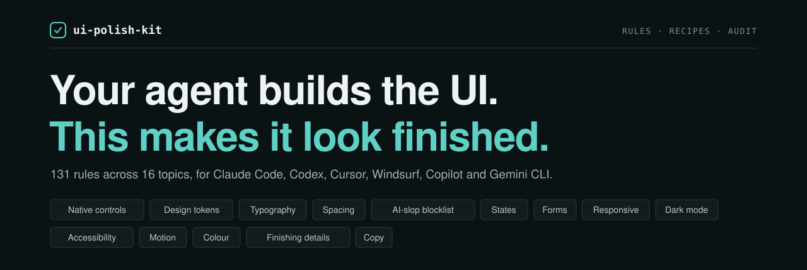
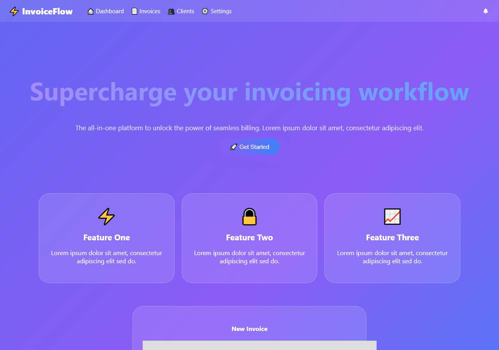
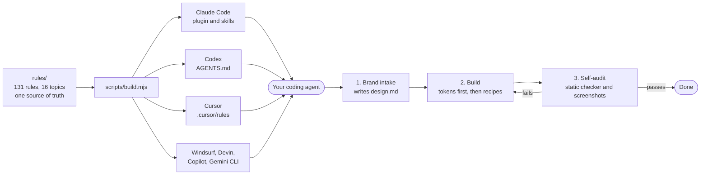

<p align="center">
  
</p>

<p align="center">
  <a href="LICENSE"></a>
  
  
  
  
  
  
  <a href="CONTRIBUTING.md"></a>
</p>

<p align="center">
  <b>Rules, recipes and an audit you hand to your AI coding agent</b><br>
  so the interfaces it builds stop looking generic and stop shipping with the gaps nobody gets round to fixing.
</p>

<p align="center">
  Works with <b>Claude Code</b> · <b>Codex</b> · <b>Cursor</b> · <b>Windsurf / Devin Desktop</b> · <b>GitHub Copilot</b> · <b>Gemini CLI</b><br>
  all generated from one set of rule files.
</p>

<p align="center">
  <a href="#install">Install</a> ·
  <a href="#the-problem">The problem</a> ·
  <a href="#what-is-inside">What is inside</a> ·
  <a href="#rule-topics">Rule topics</a> ·
  <a href="#how-the-audit-works">The audit</a> ·
  <a href="#contributing-a-rule">Contribute</a>
</p>

---

## Before and after

The same invoicing screen, built twice. Left: what an agent produces when asked for "a SaaS dashboard". Right: the same screen built with the kit's rules. Both are in [`examples/`](examples); open the two `index.html` files to compare them yourself.

<table>
  <tr>
    <th width="50%">Before: <code>examples/before</code></th>
    <th width="50%">After: <code>examples/after</code></th>
  </tr>
  <tr>
    <td></td>
    <td></td>
  </tr>
  <tr>
    <td align="center">Score <b>0 / 100</b> · 56 errors · 95 warnings</td>
    <td align="center">Score <b>100 / 100</b> · no findings</td>
  </tr>
</table>

## The problem

Ask an agent for a SaaS screen and the result usually compiles and usually has these defects:

- A styled page with a browser-default `<select>` and the blue native date-picker calendar in the middle of it.
- The same look every time: Inter, a purple-to-blue gradient, gradient headline text, emoji as icons, three identical feature cards.
- Padding that changes from card to card; colours typed as hex in forty places.
- No hover, focus, loading, empty or error states. No dark mode, or a dark mode with white dropdowns.
- "Vite + React" in the tab, no favicon, lorem ipsum, a button that says "Submit".

Some of these the developer never gets round to fixing. Others they do not know to look for. The kit gives the agent the rules up front, the components to follow them with, and a check it has to pass before it says the work is done.

## How it fits together



Each agent gets a short entry file that is always loaded (the core checklist plus a table of topic files, about 8,000 characters). The topic files are loaded on demand, because long always-on rule files get ignored.

## What is inside

| Path | What it is |
| --- | --- |
| `rules/` | The source of truth. 16 topic files, 131 rules. Each rule: the rule, why it matters, a bad example, a good example, how to check it. `_core.md` is the short always-loaded checklist. |
| `recipes/react-tailwind-shadcn/` | Token setup (CSS variables + Tailwind v4 theme, v3 config) and 26 token-styled components that replace every native control: Select, Combobox, DatePicker, TimePicker, FileUpload, Slider, ColorPicker, Checkbox, RadioGroup, Switch, Tooltip, ConfirmDialog, Toaster, and more. |
| `audit/cli.mjs` | Static checker. Node 20+, no dependencies. Reports `file:line`, rule ID, severity and a score; `--json` for machines. Covers 57 of the rules. |
| `audit/PROCEDURE.md` | The agent-facing audit: screenshot at 375 / 768 / 1440px in light and dark, walk a 29-item checklist, score, fix, re-check, report. |
| `audit/screenshot.mjs` | Captures those screenshots and reports horizontal overflow and console errors (needs `playwright-core`). |
| `templates/design.md` | Brand intake template the agent fills in before building. |
| `scripts/build.mjs` | Generates every agent format from `rules/`. Nothing is hand-duplicated. |
| `scripts/install.mjs` | Installs the kit into a project for the agents you choose. |
| `skills/`, `.claude-plugin/`, `dist/` | Generated outputs, committed so agents and the Claude Code marketplace can install straight from the repository. |
| `examples/` | Before/after pair; also the checker's test fixture. |
| `tests/` | Tests for the checker, the build and the installer. |

## Rule topics

| # | Topic | ID | What it stops |
| --- | --- | --- | --- |
| 1 | [Native controls](rules/01-native-controls.md) | NC | Browser-default selects, date pickers, file inputs, checkboxes, tooltips and `alert()` dialogs in a styled page |
| 2 | [Design tokens](rules/02-design-tokens.md) | TK | Hard-coded hex colours and arbitrary pixel values scattered through components |
| 3 | [Typography](rules/03-typography.md) | TY | The same default font every time; includes 14 Google Font pairings by product personality |
| 4 | [Spacing and layout](rules/04-spacing-layout.md) | SP | Padding that changes from card to card, no rhythm, no grid |
| 5 | [AI-slop blocklist](rules/05-ai-slop.md) | SL | Purple-to-blue gradients, gradient text, emoji as icons, glass everywhere, three identical cards |
| 6 | [Component states](rules/06-component-states.md) | ST | Missing hover, focus, disabled, loading, empty and error states |
| 7 | [Forms](rules/07-forms.md) | FM | Unlabelled inputs, badly timed validation, vague error messages |
| 8 | [Responsive](rules/08-responsive.md) | RS | Horizontal scroll, tiny touch targets, tables that break on phones |
| 9 | [Dark mode](rules/09-dark-mode.md) | DM | Inverted colours and white dropdowns in a dark theme |
| 10 | [Accessibility](rules/10-accessibility.md) | AX | Low contrast, no focus ring, clickable `<div>`s, no keyboard path |
| 11 | [Motion](rules/11-motion.md) | MO | `transition: all`, slow or pointless animation, no reduced-motion handling |
| 12 | [Colour](rules/12-colour.md) | CO | Unplanned palettes, no neutral scale, accent colour on everything |
| 13 | [Finishing details](rules/13-finishing-details.md) | FD | Scaffold page titles, no favicon, no social preview, no 404 page |
| 14 | [Copy](rules/14-copy.md) | CP | Lorem ipsum, "Feature One", buttons that say "Submit" |
| 15 | [Brand intake](rules/15-brand-intake.md) | BR | Building before anyone has written down the brand's colours, fonts and tone |
| 16 | [Self-audit gate](rules/16-self-audit.md) | SA | Declaring a UI task done without looking at it |

## Install

From a clone, `node path/to/ui-polish-kit/cli.mjs install <agent>` does the same as the `npx` form.

Every install (except the Claude Code plugin) copies the kit into `.ui-polish/` in your project and adds one entry file for the agent. Commit both.

| Agent | Command (run in your project root) | What it writes |
| --- | --- | --- |
| Claude Code (plugin) | `claude plugin marketplace add devsharmagrowleads-oss/ui-polish-kit` then `claude plugin install ui-polish-kit@ui-polish-kit` | Nothing in your project. Skills `/ui-polish-kit:ui-polish` and `/ui-polish-kit:ui-audit`. |
| Claude Code (project skills) | `npx github:devsharmagrowleads-oss/ui-polish-kit install claude` | `.claude/skills/ui-polish/`, `.claude/skills/ui-audit/` |
| Codex and any `AGENTS.md` reader | `npx github:devsharmagrowleads-oss/ui-polish-kit install codex` | A marked block in `AGENTS.md` (your own content is kept) |
| Cursor | `npx github:devsharmagrowleads-oss/ui-polish-kit install cursor` | `.cursor/rules/ui-polish-*.mdc`: one always-on rule, one description-triggered rule per topic |
| Windsurf | `npx github:devsharmagrowleads-oss/ui-polish-kit install windsurf` | `.windsurf/rules/ui-polish-*.md` |
| Devin Desktop | `npx github:devsharmagrowleads-oss/ui-polish-kit install devin` | `.devin/rules/ui-polish-*.md` (same files, current path) |
| GitHub Copilot | `npx github:devsharmagrowleads-oss/ui-polish-kit install copilot` | A marked block in `.github/copilot-instructions.md` |
| Gemini CLI | `npx github:devsharmagrowleads-oss/ui-polish-kit install gemini` | A marked block in `GEMINI.md` |
| Several at once | `npx github:devsharmagrowleads-oss/ui-polish-kit install cursor codex claude` or `install all` | |

Options: `--target <dir>` to install somewhere other than the current directory, `--dry-run` to preview. Re-running the installer updates in place.

To try the Claude Code plugin from a local clone: `claude plugin marketplace add /path/to/ui-polish-kit`, then install as above.

Manual install, if you prefer copying: copy `rules/` (without `_core.md`), `recipes/`, `audit/` and `templates/` into `<project>/.ui-polish/`, then copy the file for your agent from `dist/`.

### After installing

1. Ask the agent to do the brand intake. It looks for existing colours, fonts and tone in the repo, asks you for what is missing, and writes `design.md`.
2. Ask it to audit what exists: "run the UI audit" (Claude Code: `/ui-polish-kit:ui-audit`).
3. From then on it follows the core rules on every UI task and must pass the self-audit gate before saying it is done.

## How the audit works

Two halves, because they catch different things.

**Static checker**: reads source, no browser.

<p align="center">
  
</p>

```bash
node .ui-polish/audit/cli.mjs .                 # report with file:line, rule ID, severity, score
node .ui-polish/audit/cli.mjs . --json          # machine-readable
node .ui-polish/audit/cli.mjs . --fail-on warning --min-score 95    # stricter, for CI
node .ui-polish/audit/cli.mjs --list-rules      # every rule and whether it is checked statically
```

It detects: native `<select>`, date/time, file, range and colour inputs and default checkboxes/radios without restyling; `alert()` / `confirm()` / `prompt()`; `title=` tooltips; unstyled scrollbars and autofill; hard-coded colours outside token files; Tailwind arbitrary values (`p-[13px]`, `z-[999]`); raw palette utilities; off-scale spacing; magic z-index; missing tokens; system-only or default-prone fonts with no recorded decision; fonts loaded without `display=swap`; heading-level problems; purple/indigo-to-blue gradients (by class name and by hue); gradient text; emoji as icons; more than one icon library; overused `backdrop-blur`; glow shadows; generic hero copy; unlabelled inputs; missing `autocomplete`; missing viewport meta; fixed widths; `100vw`; missing dark tokens, `dark:` palette overrides, `filter: invert` dark mode, missing `color-scheme`; no `:focus-visible`; `outline: none` without a replacement; images without `alt` or dimensions; click handlers on `<div>`; zoom disabled; missing `lang`; unnamed icon buttons; positive `tabindex`; `transition: all`; slow transitions; no reduced-motion handling; `animate-bounce`; missing favicon, title, description, Open Graph tags, 404 page; lorem ipsum; filler names; vague microcopy; missing `design.md`.

Scoring: start at 100; an error costs 5, a warning 2, an info 0.5; one rule can cost at most three times its weight. Pass needs zero errors and a score of at least 85. Exit code 0 pass, 1 fail, 2 usage error.

False positives are kept low on purpose: the checker only fires on patterns that are wrong almost everywhere. When code is deliberately correct, suppress the finding where it occurs, with the reason:

```tsx
{/* ui-polish-ignore-next-line TK-01: partner logo colours are fixed by their brand */}
<LogoWall colors={['#e01e5a', '#36c5f0']} />
```

Also available: `ui-polish-ignore-line`, `ui-polish-disable <IDs>` … `ui-polish-enable`, `ui-polish-ignore-file <IDs>`. Project-wide settings go in `ui-polish.config.json`:

```json
{
  "exclude": ["legacy/**"],
  "tokenFiles": ["src/styles/brand.css"],
  "rules": { "TK-03": "off", "MO-01": "warning" },
  "minScore": 85,
  "failOn": "error",
  "allowSystemFonts": false,
  "darkMode": true,
  "designDoc": "docs/design.md"
}
```

**Visual audit**: the agent follows `audit/PROCEDURE.md`: starts the app, captures each page at three widths in both themes (plus open dropdowns, date pickers and dialogs, and empty, loading and error states), looks at every image, walks the 29-item checklist, does a keyboard pass, scores, fixes in priority order, re-checks, and reports scores, fixes, what remains and what it could not verify. The static checker cannot judge spacing rhythm, hierarchy or whether a page looks like a template; this half does.

```bash
npm i -D playwright-core          # uses installed Chrome or Edge
node .ui-polish/audit/screenshot.mjs http://localhost:3000/ http://localhost:3000/settings
```

## Developing the kit

```bash
npm run build         # regenerate skills/, dist/, .claude-plugin/, audit/rules-index.json, audit/CHECKLIST.md
npm run build:check   # fail if generated files are stale (use in CI)
npm test              # checker, build and installer tests
node audit/cli.mjs examples/before    # fails, about 160 findings
node audit/cli.mjs examples/after     # passes, 100/100
```

There are no dependencies and no install step.

## Contributing a rule

See [CONTRIBUTING.md](CONTRIBUTING.md). In short: add the rule to the right file in `rules/` in the five-part format, add a detector and a test if it can be checked statically, run `npm run build` and `npm test`, and commit the regenerated files with your change.

## Licence

MIT. See [LICENSE](LICENSE).
